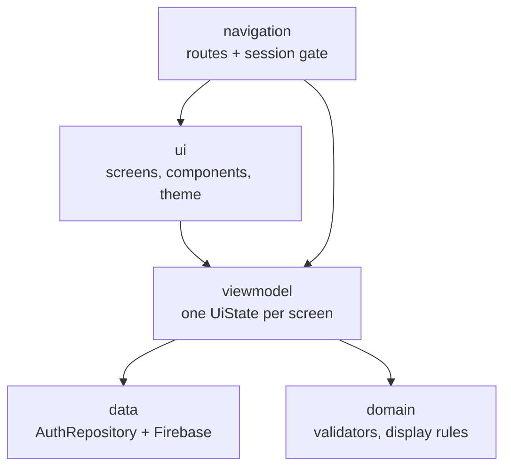
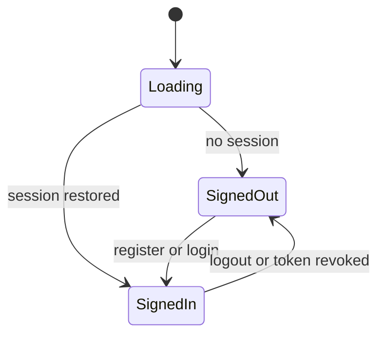
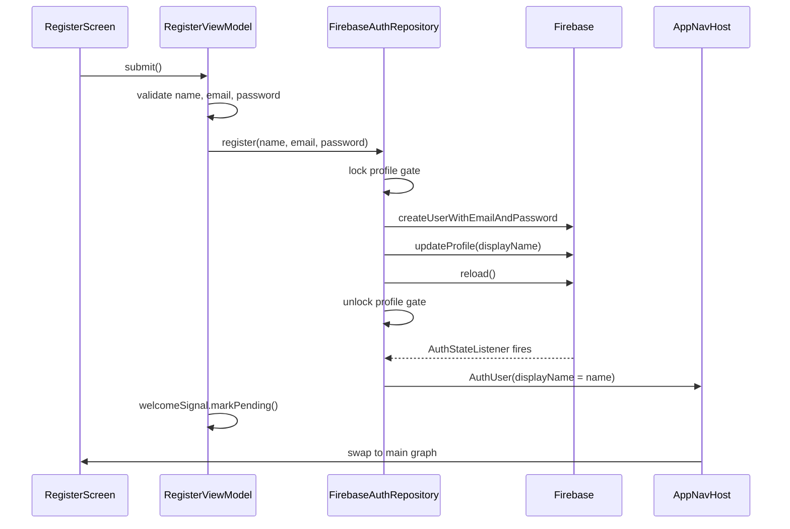
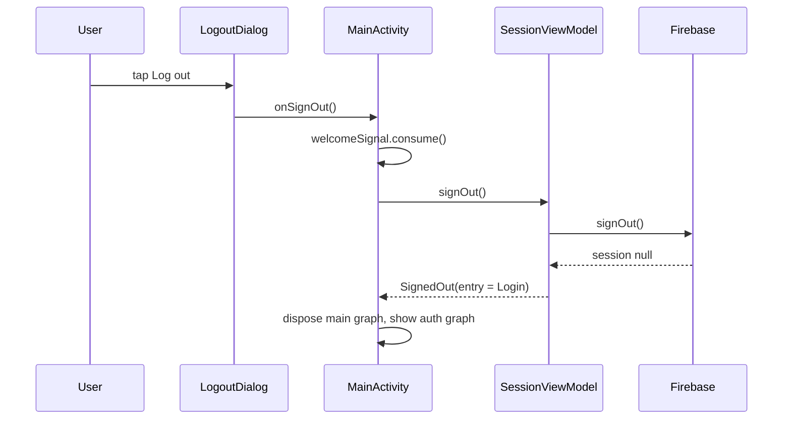

# Architecture

This document describes how NeuroVerseAuth is put together, how a session moves through
the app, and how the security requirements are met. It is the companion to
[README.md](../README.md) and [TESTING.md](TESTING.md).

---

## 1. Layers



| Layer | Package | Rule |
|---|---|---|
| UI | `ui/` | Renders state, sends events up. No business logic, no Firebase, no validation |
| ViewModel | `viewmodel/` | Owns one immutable `UiState` in a `StateFlow`. Calls the repository. No Android UI types |
| Domain | `domain/` | Pure Kotlin rules. No Android imports, fully unit-testable |
| Data | `data/` | `AuthRepository` interface, Firebase implementation, error mapping |
| Navigation | `navigation/` | Route constants, the root session gate, both graphs, shared screen transitions |

The dependency direction is enforced by inspection, not by a module boundary: there is no
`com.google.firebase` import outside `data/`, and no `androidx.compose` import inside
`data/` or `domain/`. Both are checkable with a single search.

### Why no dependency-injection library

The app has one module, five view models and one repository. `di/ServiceLocator` creates
them once and hands them out. Hilt would add an annotation processor, build time and a
second way of doing the same thing, for no benefit at this size.

---

## 2. The session gate

`AppNavHost` is the root of the composition and the only place routing is decided:



```kotlin
when (state) {
    SessionState.Loading -> SplashScreen()
    is SessionState.SignedOut -> AuthNavHost(startAtLogin = state.entry == AuthEntry.Login)
    is SessionState.SignedIn -> MainNavHost(user = state.user, ...)
}
```

**Why this protects the authenticated screens.** Compose composes exactly one branch of a
`when`; the others are not in the composition at all. `MainNavHost` — which declares `home`
and `profile` — has a single call site, inside the `SignedIn` branch. The auth graph
declares only `welcome`, `login`, `register` and `forgot_password`, so no signed-out screen
can navigate to Home or Profile even if a callback were wired wrongly. There are no deep
links in the manifest, so an external intent cannot target `home` either.

**Why it prevents a Login flash.** The initial state is `Loading`, not `SignedOut`.
Firebase restores the session from disk asynchronously; until it answers, the app shows the
splash. A signed-in user therefore never sees Welcome or Login for a frame before Home.

**What happens on logout.** `MainNavHost` leaves the composition. Its `NavController` is
forgotten and its `ViewModelStore` is cleared, so the authenticated back stack ceases to
exist. Pressing Back then belongs to the auth graph, which cannot return to Home.

### Cold start versus logout: where the auth graph opens

The gate distinguishes the two cases with a rule rather than a stored flag:

```kotlin
private var hasSignedIn = false   // survives rotation, dies with the process

if (user == null) SessionState.SignedOut(
    entry = if (hasSignedIn) AuthEntry.Login else AuthEntry.Welcome
) else {
    hasSignedIn = true
    SessionState.SignedIn(user)
}
```

- **Cold start, no session** → Welcome (the product's entry screen).
- **Session ends after one existed** (logout, revoked token, deleted account) → Login.

The field lives in the view model, so a rotation keeps the decision and a process restart
resets it. When Login is the start destination there is nothing to pop, so its back arrow
pushes Welcome instead — Welcome stays in the graph and becomes the new root.

---

## 3. Flows

### 3.1 Registration



The profile gate is the important part. `createUserWithEmailAndPassword` signs the user in
immediately and fires the auth listener, which would normally emit a user with a null
display name. The gate holds the listener until `updateProfile` and `reload` finish, so the
first `SignedIn` state already carries the name.

### 3.2 Registration edge case

If the account is created but `updateProfile` or `reload` fails (network drops mid-flight),
the registration is **not** reported as a failure. The account exists and the user is
signed in, so:

- the profile write failures are contained and do not propagate,
- the session still emits, using the cached user,
- Home falls back to the email's local part for the greeting (`UserDisplay.greetingName`),
- no spinner is left behind and nothing crashes.

The cost is that the display name may stay unset for that account; the fallback keeps the
UI correct. Treating it as a hard failure would be worse: the user would sit on the Register
screen while already authenticated.

### 3.3 Login

`signInWithEmailAndPassword` → the auth listener reloads the user → `SignedIn` → the gate
swaps to Home. Every failure is reduced to one of two outcomes:

- **Invalid credentials** (wrong password, unknown account, invalid email): one banner,
  "Email or password is incorrect."
- **Network**: snackbar with Retry, form values preserved.

### 3.4 Password reset

`sendPasswordResetEmail` is requested, but the UI result is always the same card:
*"If an account exists for that email, we've sent a reset link."*

Firebase's **email enumeration protection** makes this natural: with it enabled, an unknown
address succeeds silently; with it disabled, the call throws `ERROR_USER_NOT_FOUND`. The
view model maps that error to the same success state, so the response cannot be used to
discover which addresses have accounts. Only transport-level failures (network, rate limit,
unknown) are surfaced, and none of them depend on the account existing.

### 3.5 Logout



Every local auth artefact we own is cleared: the Firebase session, the main graph and its
view models (which hold any typed form values), and the one-shot welcome flag.

### 3.6 Session restore

Cold start → `Loading` → splash → Firebase restores from disk → `reload()` → `SignedIn` →
Home. If the cached session is no longer valid (revoked, deleted user), Firebase reports no
user and the gate shows the auth graph instead. If the reload fails while offline, the
cached user is kept, because Firebase already restored the session and signing the user out
would be wrong.

---

## 4. Error mapping

Firebase errors are converted once, at the data boundary, into `AuthError`:

| Firebase code | `AuthError` | Where it appears |
|---|---|---|
| `ERROR_INVALID_EMAIL` | `InvalidEmail` | Inline under the email field |
| `ERROR_WEAK_PASSWORD` | `WeakPassword` | Inline under the password field |
| `ERROR_EMAIL_ALREADY_IN_USE` | `EmailAlreadyInUse` | Inline under the email field |
| `ERROR_INVALID_CREDENTIAL` / `ERROR_WRONG_PASSWORD` / `ERROR_USER_NOT_FOUND` | `InvalidCredentials` | One generic banner on Login |
| `ERROR_TOO_MANY_REQUESTS` | `TooManyRequests` | Banner |
| `ERROR_NETWORK_REQUEST_FAILED`, `FirebaseNetworkException`, `IOException` | `Network` | Snackbar with Retry |
| anything else | `Unknown` | Banner |

Raw server text is never shown. `FirebaseNetworkException` is a `FirebaseException` but not
a `FirebaseAuthException`, so it needs its own branch or it would degrade to `Unknown`.

---

## 5. Security decisions

| Decision | Why | Requirement |
|---|---|---|
| Firebase Authentication as the provider | Server-side password hashing, token issuance, email verification primitives | §4 Authentication |
| Tokens owned solely by the Firebase SDK | The SDK persists tokens encrypted with an Android Keystore-backed key; copying them elsewhere would duplicate the risk | §4 Local Secure Storage, §5 token storage |
| No token, email or password logging anywhere | Logcat is readable by any debug tool and survives on device | §5 no sensitive exposure |
| `android:allowBackup="false"` | Keeps auth state out of cloud backups and device-to-device transfer | §4 storage, §5 |
| Passwords never stored by the app | Only the password field's *visibility toggle* is saved across process death, never the value | §5 passwords |
| Generic login and reset responses | Prevents account enumeration through either form | §5 safe error handling |
| Protected screens behind the gate | No route to Home or Profile exists while signed out | §5 protected screens |
| Logout clears local state | Firebase session plus every in-memory flag we own | §5 logout |
| No secrets in the repository | `google-services.json` is ignored; Firebase Android keys are restricted per project | §5 no hardcoded credentials |
| HTTPS only | Firebase endpoints are TLS-only; no custom backend is used | §5 HTTPS |
| Client-side validation | Immediate feedback; Firebase re-validates server side | §5 validation on both sides |
| Coroutines on `Dispatchers.Main` for state | Single-writer state, no shared mutable UI | §4 Asynchronous Operations |

---

## 6. Testing strategy

- Pure logic (`Validators`, `UserDisplay`, `AuthError`) is tested directly on the JVM.
- View models are tested with a hand-written `FakeAuthRepository` and
  `kotlinx-coroutines-test`; no Firebase, no Android, no device.
- The session gate is verified by reading the composition structure and by manual scenario
  8 in [TESTING.md](TESTING.md); a Compose UI test would need an instrumentation runner and
  is out of scope for this delivery.

See [TESTING.md](TESTING.md) for the scenario table and the latest unit test result.
